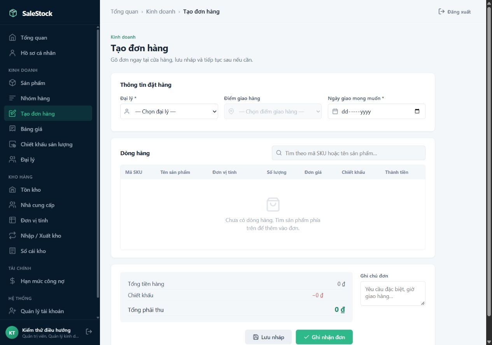
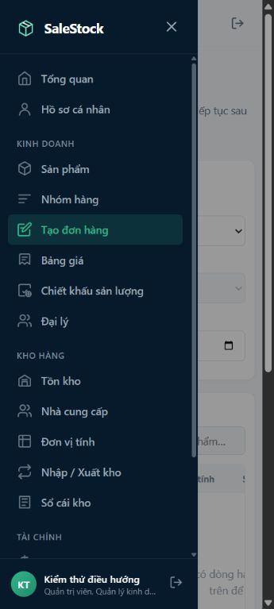

# Chạy frontend và đường dẫn trang

Từ thư mục repo, chạy một trong hai lệnh:

```powershell
.\run_frontend.ps1
# Hoặc:
python serve_frontend.py
```

Mở [trang đăng nhập](http://localhost:5500/login) hoặc
[trang tổng quan](http://localhost:5500/dashboard).
Backend vẫn chạy ở cổng 8080 theo cấu hình trong README.

| Trang | Đường dẫn |
|---|---|
| Đăng nhập | `/login` |
| Tổng quan | `/dashboard` |
| Hồ sơ | `/profile` |
| Sản phẩm | `/products` |
| Nhóm hàng | `/product-groups` |
| Bảng giá | `/price-lists` |
| Chiết khấu sản lượng | `/discount-policies` |
| Hồ sơ, tìm kiếm và khoá đại lý | `/dealers` |
| Tạo đơn hàng | `/create-order` |
| Đơn hàng của tôi / theo dõi đơn đại lý | `/dealer-orders` |
| Cổng đại lý tự đặt hàng | `/dealer-portal` |
| Hạn mức công nợ | `/dashboard?view=debt-limits` |
| Nhà cung cấp | `/suppliers` |
| Đơn vị tính | `/warehouse/units?tab=units` |
| Lập chứng từ | `/warehouse/units?tab=receipts` |
| Sổ cái kho | `/warehouse/units?tab=ledger` |
| Kiểm kê kho (S5-08) | `/warehouse/units?tab=stocktake` — VIEW hoặc ADJUST để xem/tạo/đếm, ADJUST để chốt; phiếu và số đếm lưu qua `/warehouse/stock-counts` |
| Tồn kho | `/warehouse/inventory` (tab cũ `?tab=inventory` được chuyển tiếp) |
| Ngưỡng tồn tối thiểu (S5-09) | `/warehouse/minimums` |
| Lô & hạn sử dụng (S6-01) | `/warehouse/lots` — VIEW hoặc MANAGE để xem; PRODUCT_EDIT hoặc MANAGE cấu hình SKU; EXPORT để xuất; APPROVE hoặc MANAGE để ghi đè quá hạn kèm xác nhận và lý do. ADMIN luôn được phép. |
| Thẻ kho sản phẩm (S6-02) | `/warehouse/stock-card` — WAREHOUSE_VIEW hoặc ADMIN. Chọn SKU, lọc kho/ngày, phân trang server và mở chứng từ gốc chỉ đọc; từ Tồn kho có liên kết chọn sẵn SKU/kho. Query productId/warehouseId/fromDate/toDate (ngày ISO)/page/size và sourceType/sourceId hỗ trợ mở lại. |
| Tài khoản nhân sự | `/admin/users` |
| Nhật ký thao tác | `/admin/audit-logs` |
| Quên mật khẩu | `/forgot-password` |
| Đặt lại mật khẩu | `/reset-password?token=...` |
| Trang lỗi | `/error?status=403` |

`/` mở trang đăng nhập. Các liên kết cũ như `/frontend/dashboard.html`,
`/admin/users.html` hoặc `/frontend/reset-password.html?token=...` được chuyển
sang đường dẫn mới; tham số truy vấn được giữ lại.

Server dùng thư viện chuẩn Python, không cần cài thêm package. Khi thêm trang,
cập nhật `ROUTES` trong `serve_frontend.py` và menu trong `frontend/js/menu-config.js`.
Không dùng `python -m http.server` cho các đường dẫn ngắn này.

S5-09: **Kho hàng → Ngưỡng tồn tối thiểu** cần `WAREHOUSE_MANAGE` (**Quản lý danh mục kho và vị trí**) hoặc ADMIN. Khai báo theo SKU + kho, phân biệt mức 0 với chưa khai báo. **Tồn kho** và khối cảnh báo trên **Tổng quan** cần `WAREHOUSE_VIEW` (**Xem tồn kho**), không lấy quyền thay thế từ vai trò hoặc MANAGE. `/warehouse/inventory?belowMinimum=true` chỉ hiện hàng có tồn khả dụng dưới ngưỡng. Cả hai quyền tuân theo ma trận đã lưu và phạm vi kho; khởi động lại backend/frontend sau cập nhật mã.

ADMIN mở `/dealer-orders` hoặc `/dealer-portal` sẽ chọn đại lý từ danh sách DB,
không cần gắn hồ sơ đại lý vào tài khoản admin. Sau khi chọn, URL có `?dealerId=<id>`;
mọi API cổng dùng cùng ngữ cảnh đó. Trang chưa chọn đại lý không gọi API dữ liệu
thiếu ngữ cảnh. DEALER không có bộ chọn, chỉ sử dụng hồ sơ đã liên kết và quyền
trong ma trận: theo dõi cần `ORDER_VIEW`, đặt hàng cần cả `ORDER_CREATE`, `ORDER_VIEW`,
`PRODUCT_VIEW`; nút đặt lại cần thêm `ORDER_CREATE` và `PRODUCT_VIEW`.

## Breadcrumb và mục sidebar hiện tại

Các trang nghiệp vụ dùng chung `app-navigation.js` và `app-navigation.css`.
Tên trang, nhóm chức năng và đường dẫn lấy từ `MenuConfig`:

- Trang tổng quan: `Tổng quan`.
- Hồ sơ: `Tổng quan › Hồ sơ cá nhân`.
- Các trang còn lại: `Tổng quan › Nhóm chức năng › Trang hiện tại`.
- `Tổng quan` dẫn về `/dashboard`; tên nhóm là nhãn khi chưa có trang nhóm riêng.
- Mỗi trang có một mục sidebar được tô sáng và gắn `aria-current="page"`.
  So khớp gồm cả tham số `view`/`tab`, nên công nợ không tô sáng thêm Tổng quan,
  các tab kho không chọn nhầm nhau.
- Kho có bốn mục tương ứng: Đơn vị tính, Nhập / Xuất kho, Sổ cái kho, Tồn kho.
  Khi đổi tab trên màn hình kho, breadcrumb và sidebar cập nhật ngay.
- Vai trò chỉ xem có mục Đơn vị tính tương ứng tab đọc đã có; các nút tạo/sửa
  đơn vị và lập chứng từ vẫn bị ẩn theo quyền hiện có.
- Khi thêm trang, khai báo metadata trong `MenuConfig` và tải module điều hướng
  sau `menu-config.js` (sau `app-shell.js` nếu trang cần dựng shell). Các script
  nghiệp vụ không tự dựng lại menu hoặc gán trạng thái active riêng.

Đã xác minh ngày 11/10/2026: **16 trang/tab ở 1280px và 360px**, bốn lần đổi tab
kho, đường dẫn mặc định/cũ, menu sales và chế độ chỉ xem. Kết quả:
[navigation-checks-20261011.json](navigation-checks-20261011.json).





## Kiểm tra

```powershell
python -m unittest discover -s tests -p test_frontend_server.py
node --test tests/menu-config.test.cjs
```

Đã kiểm tra đăng nhập chuyển sang `/dashboard`, điều hướng tới trang quản trị,
đường dẫn kho có tham số `tab`, vai trò chỉ xem và bố cục 360px.
Ảnh minh họa: [desktop](evidence/ui-clean-dashboard.jpg),
[mobile](evidence/ui-clean-dashboard-mobile.jpg).
