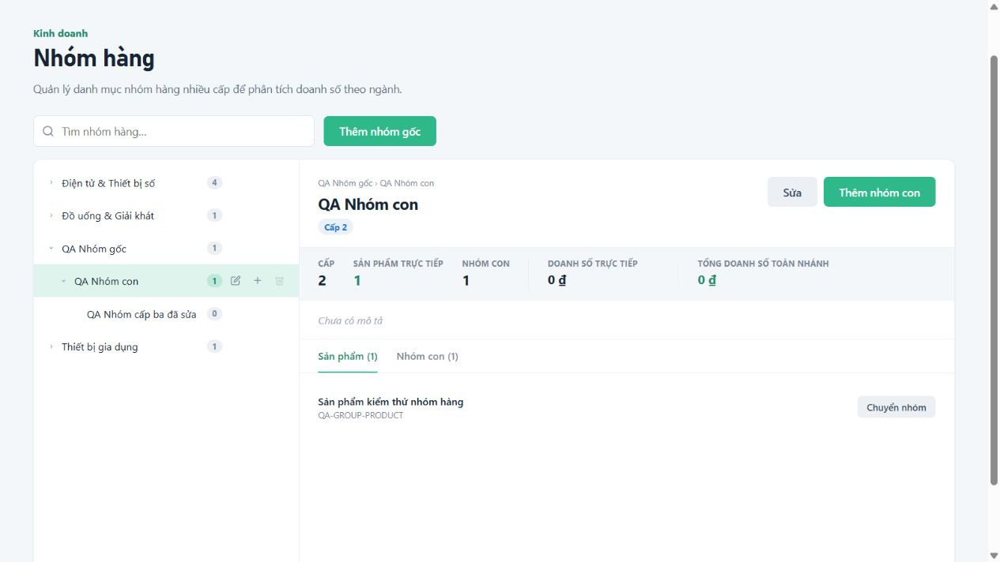

# Sửa trang Nhóm hàng — 04/10/2026

- Nạp CSS dùng chung cho layout quản trị: logo 30px, thanh đầu trang 64px.
- Giữ các nhóm cha mở để nhóm con mới tạo hoặc được chọn luôn nhìn thấy.
- Giữ đúng kết quả tìm kiếm khi cây được tải lại hoặc thu/mở nhánh.
- Cho phép chuyển sản phẩm từ nhóm cha vào nhóm con; chỉ loại nhóm hiện tại khỏi lựa chọn đích.
- Hiển thị tổng sản phẩm toàn nhánh trên cây, số sản phẩm trực tiếp trong phần chi tiết.
- Bỏ qua phản hồi sản phẩm cũ khi người dùng đã chuyển nhóm hoặc chuyển tab.
- Ẩn nút thêm nhóm gốc với vai trò chỉ xem.

Đã kiểm tra trên frontend và MySQL riêng: tạo cây ba cấp, sửa tên, tìm nhóm cấp sâu,
chuyển sản phẩm xuống nhóm con, tải lại và xác nhận dữ liệu được lưu, quyền chỉ xem,
logo/layout và màn hình 360px không tràn ngang.

