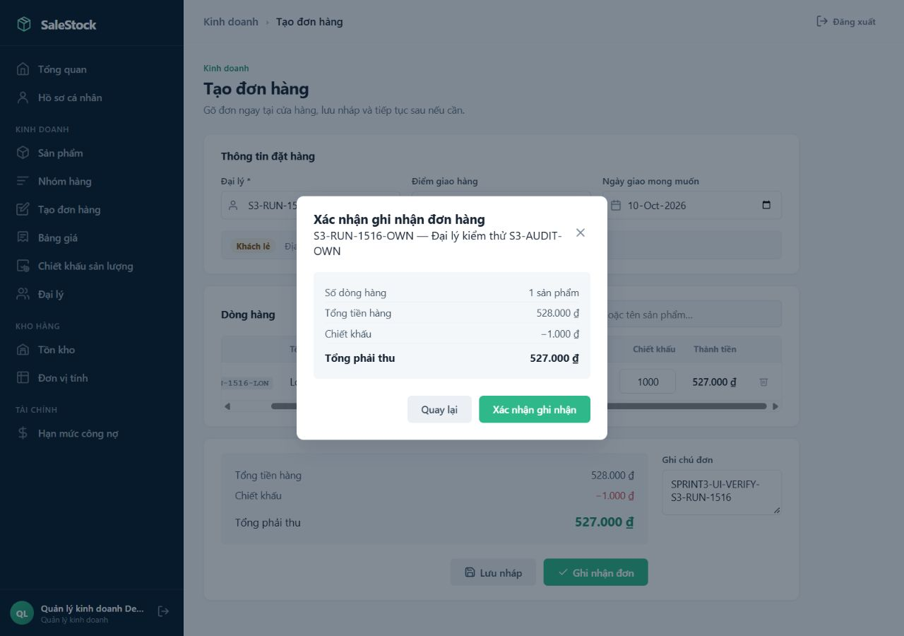
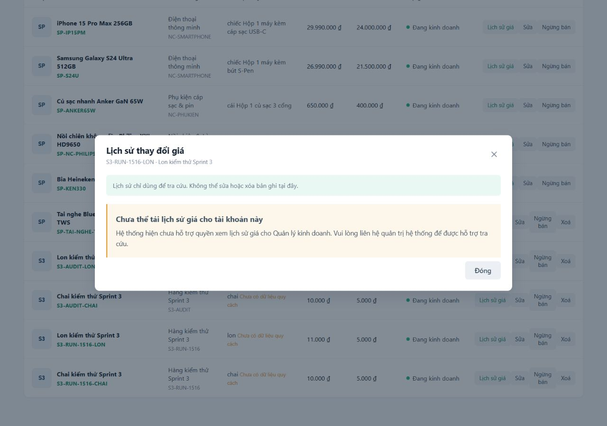
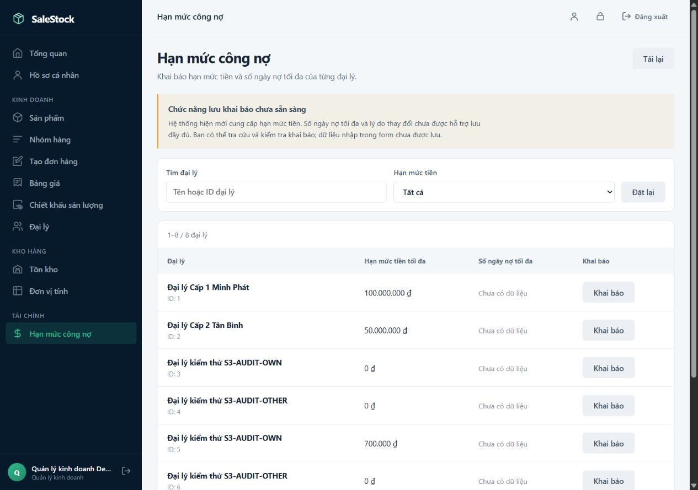
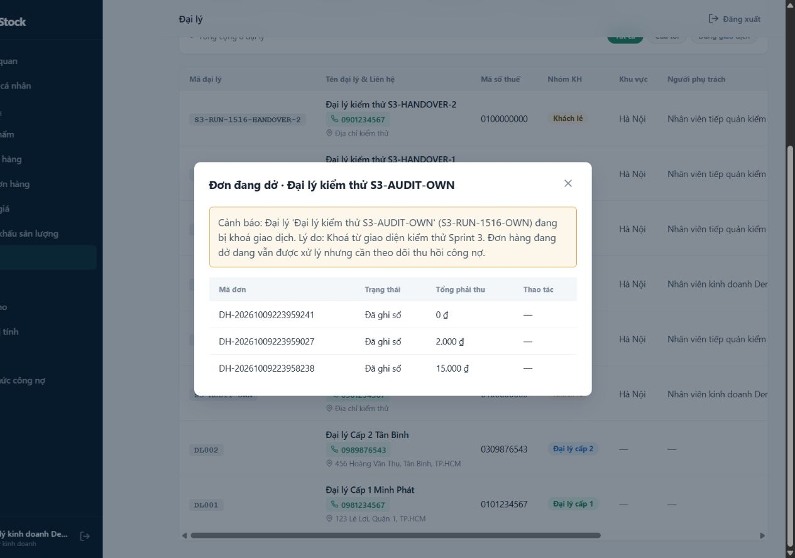
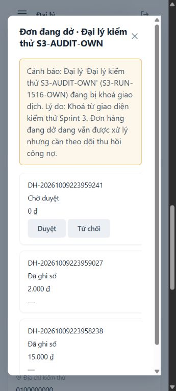

# Kiểm tra Sprint 3 — Chiết khấu và hồ sơ đại lý

Ngày kiểm tra: **09/10/2026, Asia/Bangkok**. Phạm vi: **S3-01 đến S3-09**, 9 story,
44 point trong backlog được cung cấp.

## Kết luận

**Sprint 3 chưa nối frontend/backend đầy đủ và chưa đủ điều kiện nghiệm thu.**
Các story có mã backend nền tảng, nhưng backend tạo đơn còn thiếu ngày giao và
nháp. Frontend có ở `main`, các PR hoặc nhánh riêng; riêng chuyển giao đại lý hàng
loạt/lịch sử phân công chưa có luồng giao diện. Có mã nguồn hoặc PR mang tên task
chưa đồng nghĩa với tính năng dùng được.

Đã giải quyết và đẩy conflict lên **5 PR đang mở**. GitHub xác nhận cả năm là
`MERGEABLE`/`CLEAN` trên `main` được kiểm tra. Bản tổng hợp nằm ở nhánh
`feature/kiem-tra-sprint-3`; `main` chưa được merge trong lần kiểm tra này.

## Nguồn và phạm vi xác minh

- Đã đọc `AGENTS.md`, hai skill trong `SKILLS`, backlog, các PR/nhánh Sprint 3,
  khảo sát mã nguồn và đọc các controller, DTO, entity, repository, service,
  security, frontend và kiểm thử liên quan đến các luồng của sprint.
- `main` lúc bắt đầu kiểm tra sau khi fetch: `3068154` (PR #48 và #50 đã merge).
- Revision mã nguồn tổng hợp đã chạy kiểm thử: `c595e5e`.
- Chạy API Spring Boot thật với **database MySQL riêng**; toàn bộ tài khoản,
  tên, địa chỉ, số điện thoại và giá trong bằng chứng là dữ liệu kiểm thử.
- Kiểm tra bằng trình duyệt với vai trò Quản lý kinh doanh, cả 1280px và 360px.
- [Bằng chứng gọi API](sprint3-api-checks.json): 34 phép đối chiếu, **19 đạt, 15
  chưa đạt**. Đây là các phép kiểm tra hợp đồng/quy tắc cụ thể, không phải phần
  trăm hoàn thành sprint.
- Kiểm thử tự động: **254 backend, 20 JavaScript, 5 định tuyến Python**, tất cả
  chạy thành công. Các kiểm thử này chưa bao phủ hết AC và kết nối thực tế.
- Các PR đang mở không có CI check trong `statusCheckRollup` lúc kiểm tra;
  kết quả kiểm thử nói trên được chạy tại máy local.

## Bảng từng task: backend, frontend và kết nối

| Task | Backend | Frontend | Kết quả sau khi xử lý conflict |
|---|---|---|---|
| **S3-01 — Chiết khấu sản lượng** | Có trong [PR #42](https://github.com/KoAiBitTuiLaAi/QuanLyBanHang/pull/42), chưa merge vào `main`. CRUD, bậc theo SKU/nhóm, phần trăm/số tiền, tính chính sách có lợi nhất. | Có, [PR #40](https://github.com/KoAiBitTuiLaAi/QuanLyBanHang/pull/40) đã merge, trang `/discount-policies`. | **Chưa nối đúng.** FE gọi `/discount-policies`, BE cung cấp `/volume-discounts`. DTO/enum cũng khác nhau. API thật chọn chiết khấu có lợi nhất và cộng sản lượng nhóm đúng trong các tình huống đã thử. |
| **S3-02 — Lịch sử giá** | Có, [PR #41](https://github.com/KoAiBitTuiLaAi/QuanLyBanHang/pull/41) đã merge. `GET /products/{id}/price-history`. | Có, [PR #38](https://github.com/KoAiBitTuiLaAi/QuanLyBanHang/pull/38) đã merge, modal trên `/products`. | **Chưa nối đúng cho Quản lý kinh doanh.** FE dùng nhật ký admin và chủ động chặn manager; BE riêng đã trả đúng giá cũ/mới, người sửa, thời điểm. |
| **S3-03 — Hồ sơ đại lý** | Có, [PR #43](https://github.com/KoAiBitTuiLaAi/QuanLyBanHang/pull/43) đã merge. CRUD, mã duy nhất, nhóm, khu vực, nhân viên, trạng thái. | Có, [PR #37](https://github.com/KoAiBitTuiLaAi/QuanLyBanHang/pull/37) đã merge; #46 sửa tham chiếu khu vực/người phụ trách. | **Đã nối CRUD trong bản tổng hợp, còn lỗi giá theo nhóm.** Mã trùng và xoá đại lý có giao dịch bị chặn. Tự chọn bảng giá đúng khi không truyền nhóm khác; API tạo đơn vẫn cho ghi đè nhóm của đại lý. |
| **S3-04 — Nhiều điểm giao** | Có, [PR #44](https://github.com/KoAiBitTuiLaAi/QuanLyBanHang/pull/44) đã merge. CRUD và chọn mặc định. | Có bản trên nhánh `frontend/S3-04` (`df51384`), chưa có PR mở và chưa merge. Màn hình S3-09 cũng có ô chọn điểm giao. | **Chưa nối đầy đủ.** Nhánh FE lưu `localStorage` theo tên đại lý, đưa thông tin giao vào ghi chú. FE S3-09 đọc `result.data`, BE trả mảng trực tiếp nên danh sách trống. Thiếu kiểm quyền/phạm vi tại API điểm giao; có thể bỏ hết điểm mặc định. |
| **S3-05 — Hạn mức và ngày nợ** | Có trong [PR #47](https://github.com/KoAiBitTuiLaAi/QuanLyBanHang/pull/47), chưa merge. Lưu số tiền/ngày/lý do và nhật ký qua API tài chính. | Có, [PR #45](https://github.com/KoAiBitTuiLaAi/QuanLyBanHang/pull/45) đã merge, `/dashboard?view=debt-limits`. | **Chưa nối thao tác lưu.** FE chỉ kiểm tra/xem trước, không gửi PUT; vẫn báo ngày nợ chưa có dữ liệu. BE còn cho sửa qua hồ sơ đại lý để bỏ qua lý do/nhật ký công nợ; admin được sửa dù AC chỉ cho hai vai trò nghiệp vụ. |
| **S3-06 — Phân công và chuyển giao** | Có trong [PR #49](https://github.com/KoAiBitTuiLaAi/QuanLyBanHang/pull/49), chưa merge. Gán phụ trách, bàn giao hàng loạt, lịch sử, giới hạn danh sách/chi tiết theo sales. | **Một phần:** ô người phụ trách trên hồ sơ đại lý; chưa thấy màn hình bàn giao hàng loạt hoặc lịch sử gọi các API của task. | **Chưa hoàn thiện.** API bàn giao hai đại lý và ghi lịch sử hoạt động. Danh sách/chi tiết đã giới hạn theo sales, nhưng API điểm giao và API đơn hàng còn cho đọc dữ liệu đại lý khác. |
| **S3-07 — Khoá/mở giao dịch** | Có, [PR #50](https://github.com/KoAiBitTuiLaAi/QuanLyBanHang/pull/50) đã merge. Bắt buộc lý do, chặn đơn mới, cảnh báo và tiếp tục duyệt đơn cũ. | [PR #39](https://github.com/KoAiBitTuiLaAi/QuanLyBanHang/pull/39) ban đầu dùng dữ liệu mẫu/localStorage; đã được sửa trong lần kiểm tra này. | **Đã nối luồng nội bộ.** Khoá/mở khoá thật, xem đơn đang dở và duyệt/từ chối qua API; lưu qua reload và dùng được ở 360px. **Chưa có cổng đặt hàng đại lý riêng**, nên chưa nghiệm thu luồng cổng theo AC. |
| **S3-08 — Tìm/lọc đại lý** | Có trên `/dealers`: mã/tên/điện thoại, khu vực, nhóm, phụ trách, trạng thái. | Có trong [PR #46](https://github.com/KoAiBitTuiLaAi/QuanLyBanHang/pull/46), chưa merge; đã giữ lại khi phối hợp #39. | **Đạt các AC đã kiểm tra trong bản tổng hợp.** Có bộ lọc, tìm kiếm, dropdown từ API, menu sales và bố cục mobile; API lọc được điện thoại kết hợp các điều kiện. |
| **S3-09 — Tạo đơn cho đại lý** | **Một phần:** dùng lại `OrderController`/`OrderService` đã có từ các sprint trước. Chưa có API nháp và trường ngày giao. | Có, [PR #48](https://github.com/KoAiBitTuiLaAi/QuanLyBanHang/pull/48) đã merge, `/create-order`. PR này thêm frontend, không phải một backend hoàn chỉnh cho task. | **Chưa đầy đủ.** Chọn đại lý/thêm SKU/quy đổi/gửi đơn có mã; điểm giao không tải đúng; FE/BE tính tiền khác; nháp chỉ trong `sessionStorage`; ngày giao bị bỏ qua. Route `/create-order` trước kiểm tra bị 404, đã sửa trong #39. |

## Conflict đã xử lý và nội dung được giữ

| PR | Revision sau sửa | Công việc |
|---|---|---|
| [#42 — S3-01](https://github.com/KoAiBitTuiLaAi/QuanLyBanHang/pull/42) | `d5b78df` | Giữ cả route security chiết khấu và đại lý; giữ các phần tài liệu; bổ sung mock điểm giao để kiểm thử chiết khấu chạy với `main` mới. |
| [#47 — S3-05](https://github.com/KoAiBitTuiLaAi/QuanLyBanHang/pull/47) | `133acea` | Giữ cả `maxDebtDays` và các trường khoá đại lý; giữ test công nợ và khoá; bỏ mock bị khai báo trùng sau ghép mã. |
| [#49 — S3-06](https://github.com/KoAiBitTuiLaAi/QuanLyBanHang/pull/49) | `cdf0b14` | Giữ API phân công/bàn giao cùng API khoá; giữ điều kiện lọc `locked`; loại đại lý khoá khỏi danh sách đặt hàng của sales; kiểm phạm vi khi xem đơn đang dở; thêm kiểm thử hồi quy. |
| [#46 — S3-08](https://github.com/KoAiBitTuiLaAi/QuanLyBanHang/pull/46) | `4097657` | Giữ bộ lọc/tìm kiếm, menu, route đại lý và tất cả API khoá của `main`. |
| [#39 — S3-07](https://github.com/KoAiBitTuiLaAi/QuanLyBanHang/pull/39) | `f30861d` | Phối hợp với #46, giữ CRUD/tham chiếu thật; thay dữ liệu mẫu và browser storage bằng API; thêm khoá/mở khoá, cảnh báo đơn cũ, duyệt/từ chối và route tạo đơn. |

PR #39 chứa các commit #46 để tránh thay màn hình hồ sơ/tìm kiếm bằng một màn
hình dữ liệu mẫu. Bản tổng hợp đã xử lý cả conflict phát sinh khi ghép các PR với
nhau, đồng thời giữ commit của các thành viên.

Cập nhật các nhánh PR bằng commit merge. `main` vẫn ở revision được kiểm tra.

## Lỗi cần sửa trước nghiệm thu

### P1 — S3-09: số tiền xác nhận trên giao diện khác số tiền lưu

Đã tái hiện **bằng thao tác trình duyệt**, sau đó đọc lại đơn từ API:

- Sản phẩm có giá cơ sở 11.000 đồng/lon; một thùng = 24 lon.
- Giao diện nhập 2 thùng, chiết khấu 1.000 đồng, hiển thị **527.000 đồng**.
- Bảng giá của nhóm khách hàng là 15.000 đồng/lon; backend áp đơn giá thùng
  360.000 đồng, tổng hàng 720.000 đồng và chính sách nhóm giảm 48.000 đồng.
- **Database/API lưu tổng phải thu 672.000 đồng.** Giao diện vẫn báo tạo thành
  công, không thể hiện sự khác biệt.

Nguyên nhân: [create-order.js](../frontend/js/create-order.js) gửi `unitPrice`,
`discount`, `conversionFactor`, trong khi
[OrderItemRequest.java](../backend/src/main/java/com/quanlybanhang/dto/request/OrderItemRequest.java)
nhận `price` và không có chiết khấu nhập tay. Backend tự tính theo bảng giá/chính
sách nhưng FE tự tính theo giá sản phẩm. Cần dùng kết quả tính giá của server để
hiển thị và xác nhận cùng một số tiền. Đổi đơn vị trên FE cũng chưa cập nhật tổng
ngay, chỉ đổi state rồi lưu nháp.



### P1 — S3-04/S3-06: thiếu phân quyền và phạm vi dữ liệu

- `VIEWER` tạo điểm giao của đại lý khác qua
  `POST /dealers/{id}/delivery-points`: **HTTP 200**.
- `SALES` đọc hồ sơ đại lý khác: **403**, nhưng đọc điểm giao của cùng đại lý đó:
  **200**, có dữ liệu.
- `SALES` đọc `GET /orders/{id}` của đại lý do người khác phụ trách: **200**.

[DealerDeliveryPointController.java](../backend/src/main/java/com/quanlybanhang/controller/DealerDeliveryPointController.java)
không có kiểm quyền phương thức;
[DealerDeliveryPointServiceImpl.java](../backend/src/main/java/com/quanlybanhang/service/impl/DealerDeliveryPointServiceImpl.java)
không kiểm nhân viên phụ trách. `OrderService` cũng chưa dùng phạm vi đại lý khi
đọc đơn. Cần áp dụng cùng một quy tắc quyền/phạm vi cho các đường truy cập này.

### P1 — S3-05: đi vòng qua yêu cầu lý do và nhật ký

API tài chính chuyên biệt kiểm lý do và ghi nhật ký đúng. Nhưng gửi
`PUT /dealers/{id}` kèm `debtLimit=700000`, `maxDebtDays=40`, **không có lý do**,
vẫn thành công. Số log `DEBT_LIMIT` trước/sau không tăng. Cần loại thao tác tín
dụng khỏi DTO hồ sơ hoặc buộc mọi đường sửa đi qua cùng service kiểm quyền,
kiểm lý do và ghi giá trị trước/sau.

AC chỉ cho **Kế toán công nợ và Quản lý kinh doanh** sửa; backend hiện còn cho
`ADMIN` sửa. Cần thống nhất mã với AC này.

### P1 — S3-03: nhóm đại lý có thể bị ghi đè trong đơn

Đại lý thuộc `KHACH_LE`; request tạo đơn gửi `customerGroup=DAI_LY_CAP_1`.
Server trả **201**, lưu `DAI_LY_CAP_1`, dùng giá khác nhóm hồ sơ. Cần lấy nhóm
từ đại lý tại server hoặc từ chối nhóm không khớp.

### P2 — S3-01/S3-02/S3-05: hợp đồng API và giao diện chưa thống nhất

| Luồng | Frontend hiện tại | Backend hiện tại | Việc cần làm |
|---|---|---|---|
| Chiết khấu | `/discount-policies`, `scope=SKU`, `targetId`, loại ở cấp policy | `/volume-discounts`, `targetType=PRODUCT/CATEGORY`, `productId/categoryId`, `tiers[].discountType=PERCENTAGE/FIXED_AMOUNT` | Đồng bộ đường dẫn, request và response, cả tạo/sửa/hiển thị. |
| Lịch sử giá | `/admin/audit-logs`, `oldValue/newValue/username/createdAt`; chặn manager | `/products/{id}/price-history`, `oldPrice/newPrice/modifiedBy/appliedAt`; cho manager đọc | Dùng endpoint riêng và các trường đúng. |
| Công nợ | Chỉ GET `/finance/debt`; submit form chỉ dựng preview; cột ngày luôn trống | PUT `/finance/debt/{id}/limit` nhận `debtLimit/maxDebtDays/reason` | Nối lưu, đọc lại số ngày và làm mới dữ liệu sau thành công. |
| Điểm giao | S3-09 đọc `result.data` | API trả mảng trực tiếp | Thống nhất response; không nuốt lỗi và không hiển thị danh sách trống giả. |





### P2 — Các phần còn thiếu

1. **S3-04:** đưa frontend nhánh riêng vào một PR sau khi nối API bằng `dealerId`;
   lưu điểm giao trong DB, không dùng tên đại lý/browser storage; giữ đúng một
   điểm mặc định. API hiện cho bỏ mặc định của điểm cuối, kết quả có **0 mặc định**.
2. **S3-06:** giao diện chuyển giao hàng loạt và xem lịch sử. API đã thử chuyển
   hai đại lý và đọc lại bản ghi `BULK_HANDOVER` thành công.
3. **S3-09:** trường ngày giao ở request/entity/response; API nháp có chủ sở hữu,
   mở lại và lưu trong DB. Gửi `expectedDeliveryDate` hiện bị bỏ qua;
   `POST /orders/drafts` chưa có handler, trả 500. Nháp dùng một key
   `order_draft_v1` trong `sessionStorage`, không gắn với người tạo.
4. **S3-07:** cổng đặt hàng đại lý riêng và kiểm thử từ cổng đó. Server đã chặn
   đơn mới của đại lý khoá trong API dùng cho luồng nội bộ, nhưng chưa có cổng
   để nghiệm thu từ đầu đến cuối.
5. **HTTP lỗi:** gọi DELETE lên route lịch sử chỉ đọc hoặc gọi route nháp chưa
   tồn tại đang thành 500. Cần trả mã 4xx phù hợp, không biến lỗi route thành lỗi
   server. Không có API sửa/xoá lịch sử giá trong mã hiện tại.

## Bằng chứng luồng đã sửa

Đã khoá đại lý bằng giao diện, bắt lỗi lý do trống, đọc lại đơn đang dở có cảnh
báo, duyệt đơn cũ khi đại lý vẫn khoá, mở khoá và tải lại trang. Dữ liệu được
đọc/ghi qua backend, không còn mẫu hồ sơ hoặc trạng thái đơn trong `localStorage`.





## Lệnh kiểm thử

```powershell
cd backend
.\mvnw.cmd test
cd ..
node --test tests/*.test.cjs
python -m unittest discover -s tests -p test_frontend_server.py
```

Phạm vi xác minh là source/PR hiện tại, API thật trong môi trường riêng và các
luồng trình duyệt đã nêu. Chưa có kiểm thử với cổng đại lý, dữ liệu vận hành thật,
tải lớn hoặc triển khai production.
