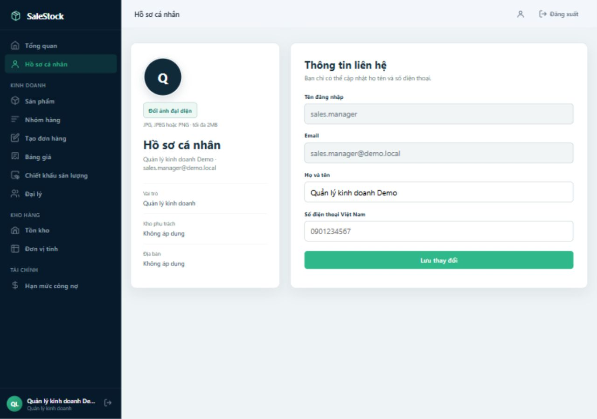
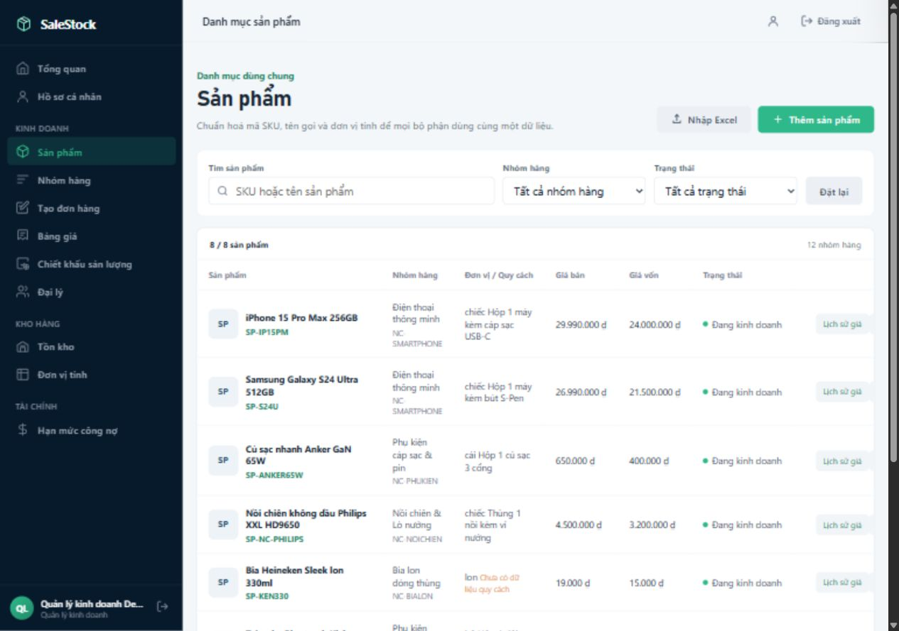

# Kiểm tra Sprint 3 — ngày 11/10/2026

Phạm vi: **S3-01 đến S3-09**, 9 story / 44 point trong backlog nhóm cung cấp.
Múi giờ: Asia/Bangkok. `main` đối chiếu: `d1b6faf`. Bản tổng hợp:
`feature/hoan-thien-sprint-3`; revision code đã xác minh: `1b343219`.

## Kết luận

**Cả 9 task đều có mã frontend và backend trong bản tổng hợp, nhưng Sprint 3
chưa đạt toàn bộ tiêu chí nghiệm thu.** Những sửa gần đây đã nối phần lớn luồng
nghiệp vụ. Các lỗi còn lại chủ yếu nằm ở kiểm quyền/phạm vi phía server, việc
áp bảng giá và bảo vệ thay đổi công nợ. Cổng đặt hàng đại lý chưa có để kiểm thử.

Riêng trên `main`, màn hình bàn giao đầy đủ của **S3-06** còn ở PR #56; ngày giao
và bản nháp trong database của **S3-09** còn ở PR #57. Bản tổng hợp chứa cả hai
PR cùng các sửa lỗi dưới đây. Chưa merge trực tiếp vào `main` trong lần làm này.

## Backend, frontend và kết nối của từng task

| Task | Backend | Frontend | Kết quả kiểm tra |
|---|---|---|---|
| **S3-01 — Chiết khấu sản lượng** | Có trên `main`: `VolumeDiscountController`, `VolumeDiscountPolicyServiceImpl`, `/volume-discounts`. | Có trên `main`, PR #52 đã nối `/discount-policies` với endpoint và DTO đúng. | **Đã nối các AC được thử.** Tạo chính sách qua UI, reload còn dữ liệu; bậc theo SKU/nhóm, phần trăm/số tiền hoạt động. API chọn mức có lợi nhất và cộng sản lượng nhóm. Quy tắc đã ghi trong tài liệu API. |
| **S3-02 — Lịch sử giá** | Có trên `main`: `GET /products/{id}/price-history`, bảng `product_price_history`. | Có trên `/products`, PR #53; Quản lý kinh doanh gọi API riêng. | **Đã nối.** UI hiện giá 10.000 → 11.000, người sửa và thời điểm. Thử PUT/DELETE không thay đổi lịch sử. Tuy nhiên hai method không hỗ trợ đang trả **500**, nên sửa về 405. |
| **S3-03 — Hồ sơ đại lý** | Có trên `main`: `DealerController`, `DealerServiceImpl`, `/dealers`, tham chiếu nhóm/khu vực/phụ trách. | Có trên `/dealers`; CRUD, trạng thái và danh mục tham chiếu dùng API. | **CRUD đã nối, chưa đạt toàn bộ AC về nhóm giá.** Kế toán tạo hồ sơ qua UI, reload giữ mã/tên/thuế/nhóm/khu vực/phụ trách. Mã trùng và xoá đại lý có giao dịch bị chặn. API tạo đơn còn nhận nhóm hoặc bảng giá trái với nhóm của đại lý. Ô Ghi chú trong hồ sơ chưa được lưu. |
| **S3-04 — Điểm giao hàng** | Có trên `main`: `DealerDeliveryPointController`, `DealerDeliveryPointServiceImpl`. | PR #54 đã merge; modal điểm giao trên `/dealers`, chọn điểm trên `/create-order`. | **Đã nối CRUD/chọn mặc định, còn lỗi server.** Sales thêm điểm giao cho đại lý của mình và đặt mặc định, reload giữ dữ liệu. API chặn điểm giao của đại lý khác trong đơn. Nhưng API điểm giao chưa kiểm vai trò/phạm vi; còn cho bỏ hết điểm mặc định. |
| **S3-05 — Hạn mức và ngày nợ** | Có trên `main`: `FinanceController`, `PUT /finance/debt/{id}/limit`, `DebtLimitRequest`, audit log. | PR #55 đã merge; `/dashboard?view=debt-limits` gửi PUT thật. | **Luồng lưu đã nối, chưa đạt AC về quyền/lý do.** UI lưu 2.500.000đ / 45 ngày và reload giữ dữ liệu; API lưu lý do, người sửa, trước/sau. Nhưng ADMIN vẫn sửa được dù AC chỉ cho kế toán và quản lý; `PUT /dealers/{id}` còn sửa công nợ không cần lý do/nhật ký công nợ. |
| **S3-06 — Phân công và bàn giao** | Có trên `main`: phân công, bàn giao theo danh sách/khu vực/toàn bộ, lịch sử, cờ cần bàn giao. | Giao diện đầy đủ ở **PR #56**, đã giải quyết conflict và sửa chọn nhân viên đã khóa. | **Đã nối thao tác phân công/bàn giao/lịch sử, còn lỗi phạm vi server.** Bàn giao nhân viên đã nghỉ qua UI thành công. Danh sách/chi tiết đại lý giới hạn theo sales. Tuy nhiên API điểm giao và API đọc/tạo đơn còn cho sales thao tác đại lý ngoài tuyến. Ghi chú bàn giao gửi lên nhưng không được lưu. |
| **S3-07 — Khóa/mở giao dịch** | Có trên `main`: bắt buộc lý do, chặn đơn mới, cảnh báo đơn cũ và cho xử lý tiếp. | Có trên `/dealers`, module `dealer-transactions.js`; thao tác khóa/mở/xem đơn gọi API. | **Luồng nội bộ đã nối.** Kế toán khóa qua UI, reload vẫn khóa; đơn cũ có cảnh báo. API chặn đơn mới và vẫn duyệt được đơn cũ khi đại lý khóa. **Chưa có cổng đặt hàng đại lý** để nghiệm thu nhánh cổng theo AC. |
| **S3-08 — Tìm và lọc đại lý** | Có trên `/dealers`: mã/tên/điện thoại, khu vực, nhóm, phụ trách, active/locked. | Có trên `/dealers`: tìm nhanh, bộ lọc, phân trang và bố cục mobile. | **Đạt các AC đã thử.** API tìm theo mã/tên/điện thoại và kết hợp bộ lọc. UI sales tìm đúng đại lý; API danh sách không trả đại lý ngoài phạm vi sales. |
| **S3-09 — Tạo đơn cho đại lý** | Nền tạo đơn có trên `main`; **PR #57** thêm `expectedDeliveryDate`, `OrderDraft`, GET/PUT/DELETE `/orders/draft`. | Có trên `/create-order`; PR #57 cùng sửa trong lần này kết nối ngày giao, điểm giao, giá, chiết khấu và nháp. | **Các AC của luồng chính đã nối và được thử**, còn phụ thuộc các lỗi giá/phạm vi ở S3-03/S3-06. Nháp lưu trong MySQL, riêng theo người dùng, mở lại giữ điểm giao không mặc định/ngày/ghi chú/đơn vị/số lượng. Tạo đơn ở 360px: UI xác nhận 576.000đ, server lưu đúng 576.000đ. Mở nháp sau khi hệ số thùng đổi 24 → 30: UI/server cùng 720.000đ; đơn cũ giữ hệ số 24. |

“Đã nối” trong bảng là kết quả của các luồng đã kiểm tra, không xác nhận tất cả
tình huống, mọi vai trò hoặc toàn bộ sprint đã sẵn sàng triển khai.

## Các sửa đổi đã thực hiện

### PR #56 — Phân công đại lý

- Merge `main` vào nhánh PR để giải quyết conflict tại `dealers.html`,
  `dealers.css`, `dealers.js`.
- Giữ đồng thời modal phân công/bàn giao/lịch sử của S3-06 và modal điểm giao
  của S3-04, cùng các thao tác khóa giao dịch.
- Dropdown người bàn giao lấy thêm người đang phụ trách đại lý, kể cả người
  đã khóa. Dropdown người tiếp nhận vẫn dùng danh sách nhân viên đang hoạt động.
- [PR #56](https://github.com/KoAiBitTuiLaAi/QuanLyBanHang/pull/56), head sau sửa
  `ff5d642`. GitHub xác nhận merge được với `main` khi kết thúc kiểm tra.

### PR #57 — Tạo đơn hàng

- Merge `main` vào nhánh PR; giữ điểm giao mặc định và ưu tiên điểm giao đã
  lưu trong nháp khi khôi phục.
- Sửa mất ô số lượng đang nhập khi API chiết khấu trả về; cập nhật tiền ngay
  khi nhập số lượng, cập nhật các ô tiền thay vì dựng lại dòng hàng.
- Đồng bộ cách tính đơn giá quy đổi với backend; tính lại chiết khấu trước
  khi mở xác nhận, chặn xác nhận nếu chưa tính được.
- Xếp các lần lưu nháp theo thứ tự và chờ lưu xong trước khi xoá nháp sau tạo đơn.
- Mở nháp lấy lại sản phẩm, đơn vị quy đổi và giá hiện tại từ API.
- Cập nhật tài liệu API về nháp và ngày giao.
- [PR #57](https://github.com/KoAiBitTuiLaAi/QuanLyBanHang/pull/57), head sau sửa
  `8221632`. GitHub xác nhận merge được với `main` khi kết thúc kiểm tra.

### Sidebar các trang nghiệp vụ

Thêm thành phần điều hướng dùng chung cho **7 trang**: `/profile`, `/products`,
`/product-groups`, `/price-lists`, `/discount-policies`, `/admin/users`,
`/admin/audit-logs`.

- Menu lấy từ vai trò/quyền đăng nhập; hiển thị người dùng, vai trò, kho/địa bàn.
- Đánh dấu trang hiện tại; đăng xuất gọi luồng Auth hiện có.
- Desktop có sidebar; mobile có nút mở, overlay, đóng/Escape và kiểm soát focus.
- Đã kiểm tra cả 7 trang; kiểm tra hồ sơ/sản phẩm ở 360px và menu sales không
  hiện bảng giá, công nợ hoặc quản trị.

## Lỗi còn lại trước nghiệm thu

| Mức | Task | Bằng chứng và việc cần làm |
|---|---|---|
| **P1** | S3-06, S3-04, S3-09 | Sales đọc điểm giao của đại lý ngoài tuyến được **200**, tạo đơn cho đại lý ngoài tuyến được **201**, đọc danh sách/chi tiết đơn ngoài tuyến được **200**. Thêm kiểm phạm vi thống nhất vào service điểm giao và đơn hàng, gồm đọc/tạo/hủy. Không dựa vào dropdown FE để bảo vệ dữ liệu. |
| **P1** | S3-04 | VIEWER tạo điểm giao được **200**; tài khoản kho đọc điểm giao được **200**. Controller điểm giao chưa có kiểm quyền tương ứng các API đại lý. Thêm kiểm vai trò cho từng method và kiểm phạm vi cho sales. |
| **P1** | S3-05 | `PUT /dealers/{id}` đổi hạn mức thành 9.000.000đ / 120 ngày mà không có lý do, được **200**. Chặn thay đổi công nợ qua hồ sơ hoặc đưa mọi đường sửa về cùng luồng kiểm quyền/lý do/audit. |
| **P1** | S3-05 | ADMIN gọi API đổi hạn mức được **200**, trái AC “chỉ Kế toán công nợ và Quản lý kinh doanh”. FE đã ẩn nút cho admin, server vẫn cần sửa. |
| **P1** | S3-03, S3-09 | Đại lý `KHACH_LE` gửi `customerGroup=DAI_LY_CAP_1` thì đơn lưu nhóm khác; gửi bảng giá của nhóm khác cũng được **201**. Server phải lấy nhóm từ đại lý và kiểm tra nhóm/hiệu lực bảng giá chỉ định. |
| **P2** | S3-04 | PUT bỏ cờ mặc định trả **200**, danh sách còn **0** điểm mặc định. Đảm bảo còn đúng một điểm mặc định khi danh sách không rỗng; xử lý cả cập nhật/xóa điểm mặc định. |
| **P2** | S3-03 | Ô **Ghi chú hồ sơ** xuất hiện trên FE nhưng không có trong payload/DTO/entity. Đã nhập qua UI rồi reload: ô trống. Nối dữ liệu này hoặc bỏ ô chưa hỗ trợ. Đây là tính năng ngoài danh sách AC được cung cấp. |
| **P2** | S3-06 | FE gửi `notes` khi bàn giao, request backend nhận trường này nhưng không lưu vào lịch sử/response. Lưu ghi chú hoặc bỏ ô chưa hỗ trợ; AC ghi lịch sử/lý do hiện đã hoạt động. |
| **P2** | S3-02 | PUT/DELETE lịch sử bị từ chối và dữ liệu không đổi, nhưng trả **500**. Bổ sung xử lý HTTP method không hỗ trợ để trả 405; không phải lỗi lịch sử đã bị sửa/xóa. |
| **Chưa kiểm được** | S3-07 | Chưa có giao diện/tài khoản/luồng cổng đặt hàng đại lý để thử AC “kể cả trên cổng”. API đơn nội bộ đã chặn đại lý khóa. |

Một số giới hạn cần lưu ý khi mở rộng kiểm thử: lịch sử giá hiện phản ánh giá cơ
sở của SKU; chưa chứng minh lịch sử giá riêng của từng bảng giá/nhóm. Giá/chính
sách thay đổi trong lúc hộp xác nhận đang mở và mất mạng giữa tạo đơn/xoá nháp
chưa được kiểm tra đầy đủ trong lần này. Vai trò kho được khai báo quyền tạo
đơn nhưng API danh sách đại lý hoạt động chưa cho vai trò kho truy cập; cần
thống nhất nếu nhóm muốn dùng màn hình này cho nhân viên kho.

## Kiểm thử và bằng chứng

- Đọc `AGENTS.md`, toàn bộ hai hướng dẫn trong `SKILLS`, backlog, PR và khảo sát
  279 file nguồn/kiểm thử/hướng dẫn (45.325 dòng); đọc các controller, service,
  model, DTO, repository, security và frontend liên quan Sprint 3.
- **254 kiểm thử backend**, **20 JavaScript**, **5 định tuyến Python** chạy thành
  công. `mvn package` thành công. Cú pháp toàn bộ JS cấp trang được kiểm tra.
- Backend Java không thay đổi giữa revision chạy kiểm thử `e6c846f3` và code
  cuối `1b343219`; những thay đổi sau đó là frontend/tài liệu.
- Gọi API Spring Boot thực với **MySQL database riêng**, frontend tại cổng 5501,
  backend tại cổng 8081. Tài khoản, địa chỉ, điện thoại và giao dịch trong bằng
  chứng là dữ liệu kiểm thử. Server ứng dụng đang có ở 5500/8080 được giữ lại.
- [55 phép đối chiếu API](sprint3-api-checks-20261011.json): 39 đạt, 16 chưa đạt
  ở lần đo ban đầu. Một kiểm tra dropdown đã được sửa và xác minh bằng UI;
  15 phép đối chiếu API còn lại chưa đạt, gồm cả kiểm tra HTTP/ghi chú ngoài AC.
- [23 kiểm tra UI sau sửa](sprint3-ui-checks-20261011.json): **22 đạt**, 1 chưa
  đạt là ô Ghi chú hồ sơ không lưu. File cũng giữ hai lần tái hiện lỗi trước sửa.
- [5 phép đọc lại đơn từ backend](sprint3-ui-order-readback-20261011.json): tất
  cả đạt, gồm tổng tiền/ngày/điểm giao, nháp không xuất hiện lại và hệ số lịch sử.
- Các PR lúc kiểm tra không có CI check; các kết quả trên được chạy tại máy.
  Số phép thử không phải tỷ lệ hoàn thành sprint và không thay thế các AC còn thiếu.

### Bằng chứng giao diện chính

- [Tạo chiết khấu](evidence/sprint3-discount-ui-20261011.png),
  [lịch sử giá](evidence/sprint3-price-history-20261011.png).
- [Điểm giao](evidence/sprint3-delivery-point-ui-20261011.png),
  [lưu hạn mức/ngày nợ](evidence/sprint3-debt-limit-ui-20261011.png).
- [Bàn giao nhân viên đã khóa sau sửa](evidence/sprint3-handover-departed-fixed-20261011.png),
  [lịch sử bàn giao](evidence/sprint3-handover-history-20261011.png).
- [Nháp khôi phục](evidence/sprint3-order-draft-20261011.png),
  [xác nhận đơn 360px](evidence/sprint3-order-confirm-mobile-20261011.png),
  [nháp lấy hệ số mới](evidence/sprint3-order-fresh-conversion-20261011.png).
- [Đơn cũ của đại lý khóa](evidence/sprint3-locked-old-orders-ui-20261011.png),
  [ô ghi chú chưa lưu](evidence/sprint3-dealer-notes-gap-20261011.png).

## Đề nghị chia việc cho nhóm

1. Backend: đóng lỗ hổng phạm vi sales/điểm giao, đường sửa công nợ và áp bảng giá.
2. Backend: giữ đúng điểm giao mặc định, lưu các trường ghi chú đang nhận, trả
   đúng mã HTTP cho method không hỗ trợ.
3. Frontend + backend: thống nhất cổng đặt hàng và vai trò kho nếu nằm trong
   phạm vi nghiệm thu; thử lại những tình huống giá/mạng thay đổi.
4. Chạy lại các trường hợp chưa đạt và nghiệm thu theo từng AC, sau khi các PR
   được đưa vào bản ứng dụng nhóm chạy chung.
